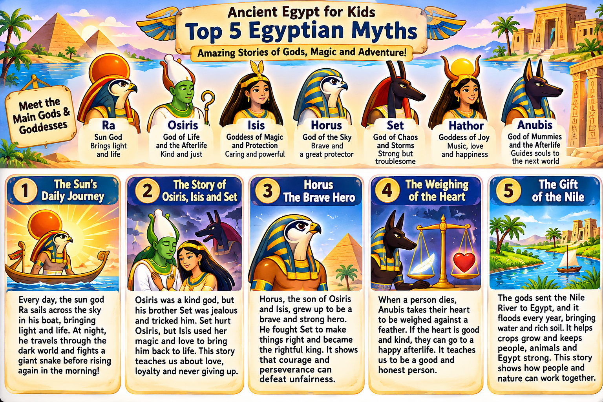
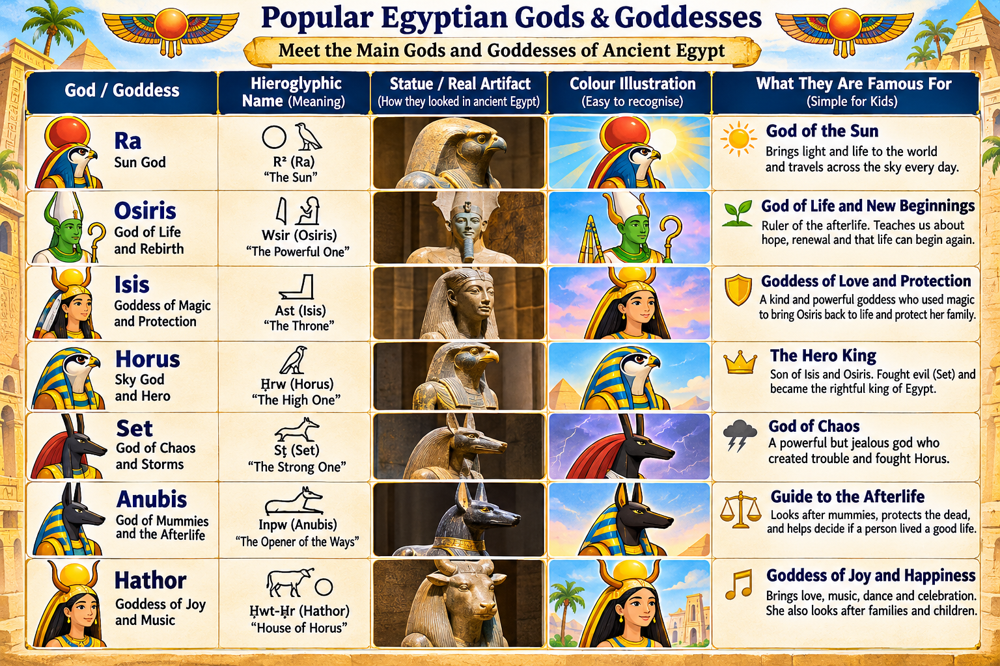

# Egyptian Mythology for Kids

Stories, pictures and activities about the gods and myths of ancient Egypt, written for children aged 5 to 12.

## Contents

| Collection | Age | What it is |
|---|---|---|
| [Five Stories from Ancient Egypt](stories/five-stories/) | 5–7 | An illustrated storybook introducing ten gods through five myths |
| [Top 5 Egyptian Myths poster](posters/top-5-egyptian-myths.png) | 5–12 | One-page poster: seven main gods and five myths at a glance |
| [Popular Egyptian Gods & Goddesses poster](posters/popular-egyptian-gods-and-goddesses.png) | 7–12 | Reference chart: name, hieroglyphic name, statue, illustration and what each god is famous for |

### Five Stories from Ancient Egypt

- `index.html` – the storybook as a web page (open in any browser)
- `print.html` – the A4 print layout
- `Five-Stories-from-Ancient-Egypt.pdf` – ready-to-print PDF, 6 pages

The five stories: Ra and the Sun Boat · The Sky, the Earth and Five Extra Days · Isis Finds Osiris · Horus and the Magic Eye · The Heart and the Feather.

### Posters

## Content rules

- Everything here is for readers aged 5 to 12.
- Short sentences and simple words. Each god's name comes with a say-it-aloud guide.
- The darker parts of the myths are softened, and a note for grown-ups says so.
- Illustrations are original drawings.
